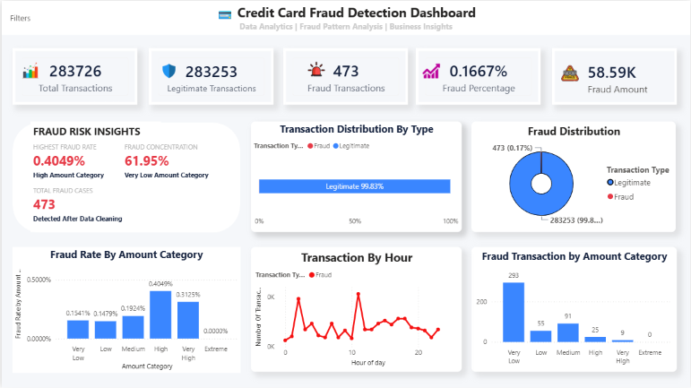
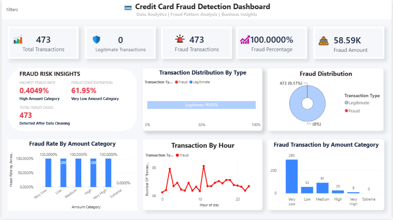
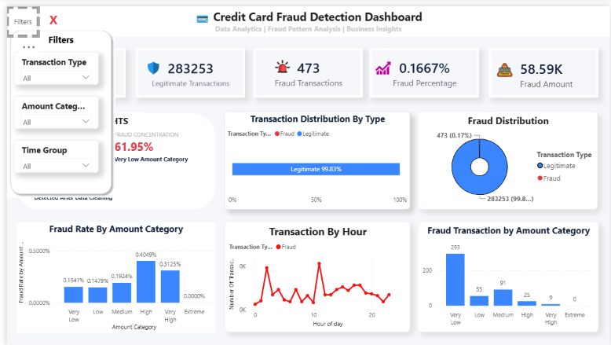

# Credit Card Fraud Detection and Analysis

An end-to-end data analytics and machine learning project focused on identifying fraudulent credit card transactions through exploratory data analysis, interactive Power BI visualizations, and Logistic Regression.

## Project Overview

Credit card fraud is a major challenge in digital payments. This project analyzes transaction data to identify fraud patterns, understand transaction behaviour, and build a machine learning model to distinguish fraudulent transactions from legitimate ones.

The project combines Python-based data analysis, machine learning, and an interactive Power BI dashboard to present meaningful insights.

## Project Objectives

- Analyze credit card transaction data and identify fraud patterns.
- Understand the distribution of legitimate and fraudulent transactions.
- Explore relationships between transaction amounts, time, and fraud occurrence.
- Build a classification model using Logistic Regression.
- Evaluate model performance using appropriate classification metrics.
- Develop an interactive Power BI dashboard for visual analysis.

## Dataset Information

- **Dataset:** European Credit Card Fraud Detection
- **Original records:** 284,807 transactions
- **Legitimate transactions:** 284,315
- **Fraudulent transactions:** 492
- **Features:** 30 input features and 1 target column (`Class`)

The dataset contains anonymized numerical features (`V1` to `V28`), transaction time, transaction amount, and a class label.

`Class = 0` represents legitimate transactions, while `Class = 1` represents fraudulent transactions.

**Note:** The dataset is not included in this repository. Download it from Kaggle and place `creditcard.csv` inside the `data` folder before running the notebook.

## Tools and Technologies

- **Python** – Data analysis and model development
- **Pandas & NumPy** – Data manipulation and preprocessing
- **Matplotlib & Seaborn** – Data visualization
- **Scikit-learn** – Machine learning and model evaluation
- **Jupyter Notebook** – Development environment
- **Microsoft Power BI** – Interactive dashboard development
- **Git & GitHub** – Version control and project hosting
- **Git LFS** – Power BI dashboard file storage

## Data Analysis

The exploratory analysis covers:

- Distribution of legitimate and fraudulent transactions.
- Fraud transaction patterns over elapsed time.
- Transaction amount category analysis.
- Fraud rates across different transaction amount categories.
- Identification of patterns and potential fraud indicators.

### Key Findings

- The cleaned dataset contains **283,726 transactions**.
- It includes **283,253 legitimate transactions** and **473 fraudulent transactions**.
- Fraudulent transactions account for approximately **0.1667%** of the cleaned dataset.
- High-value transactions showed the highest fraud rate among the defined amount categories.
- Very-low-value transactions accounted for the largest share of detected fraud cases.

## Machine Learning Model

**Algorithm:** Logistic Regression

Logistic Regression was implemented as a binary classification model to distinguish legitimate transactions from fraudulent transactions.

### Model Performance

| Evaluation Metric | Score |
|---|---:|
| Accuracy | 99.91% |
| Precision | 82.67% |
| Recall | 63.27% |
| F1-Score | 71.68% |

The dataset is highly imbalanced. Therefore, accuracy alone is not sufficient to evaluate the model.

The recall score indicates that the model identified approximately 63.27% of actual fraudulent transactions in the test set. Precision indicates that approximately 82.67% of the transactions predicted as fraud were actually fraudulent.

## Power BI Dashboard

An interactive Power BI dashboard was developed to explore transaction patterns and fraud-related insights.

**Dashboard features:**
- Total transaction, legitimate transaction, and fraud KPIs.
- Fraud percentage and fraud amount indicators.
- Transaction distribution analysis.
- Fraud distribution by elapsed hour.
- Fraud analysis by transaction amount category.
- Fraud rate comparison across amount categories.
- Interactive slicers and a collapsible filter panel.

### Dashboard Preview

### Dashboard Overview


### Fraud Analysis


### Interactive Filters



## Project Demonstration

### Short Dashboard Preview
[▶ Watch the short Power BI dashboard demonstration](https://youtu.be/JqOlvv-trFA)

### Detailed Dashboard Walkthrough
[▶ Watch the detailed Power BI dashboard walkthrough](https://youtu.be/qPXMjg227mY)


## Project Structure

```text
Credit-Card-Fraud-Detection-Analysis/
│
├── Dashboard/
│   └── credit card fraud detection & analysis dashboard.pbix
│
├── Images/
│   ├── alert icon.png
│   ├── analysis icon.jpg
│   ├── chart icon.png
│   ├── shield icon.png
│   └── trending up icon.png
│
├── Notebooks/
│   └── Credit_Card_Fraud_Detection_Analysis.ipynb
│
├── data/
│   └── creditcard.csv  (download separately)
│
├── .gitattributes
├── .gitignore
└── README.md
```

## How to Run the Project

1. Clone the repository:

   ```bash
   git clone https://github.com/aksharasanboyina/Credit-Card-Fraud-Detection-Analysis.git
   ```

2. Navigate to the project directory:

   ```bash
   cd Credit-Card-Fraud-Detection-Analysis
   ```

3. Download the European Credit Card Fraud Detection dataset from Kaggle and place `creditcard.csv` inside the `data` folder.

4. Install the required Python libraries:

   ```bash
   pip install pandas numpy matplotlib seaborn scikit-learn jupyter
   ```

5. Open Jupyter Notebook:

   ```bash
   jupyter notebook
   ```

6. Open `Notebooks/Credit_Card_Fraud_Detection_Analysis.ipynb` and run the cells.

**Power BI Dashboard:** Open the `.pbix` file in Microsoft Power BI Desktop.

## Future Enhancements

- Experiment with additional classification algorithms.
- Improve fraud detection recall through class imbalance handling.
- Explore advanced anomaly detection techniques.
- Develop a web-based interface for fraud prediction and analysis.

## Author

**Akshara Sanaboina**

B.Tech – Computer Science and Engineering

GitHub: [aksharasanboyina](https://github.com/aksharasanboyina)

---

*If you find this project useful, feel free to explore the repository and share your feedback.*